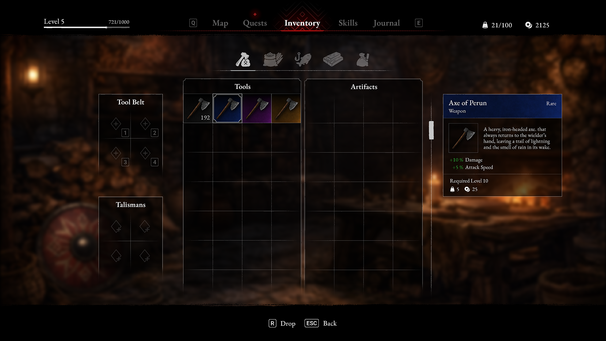
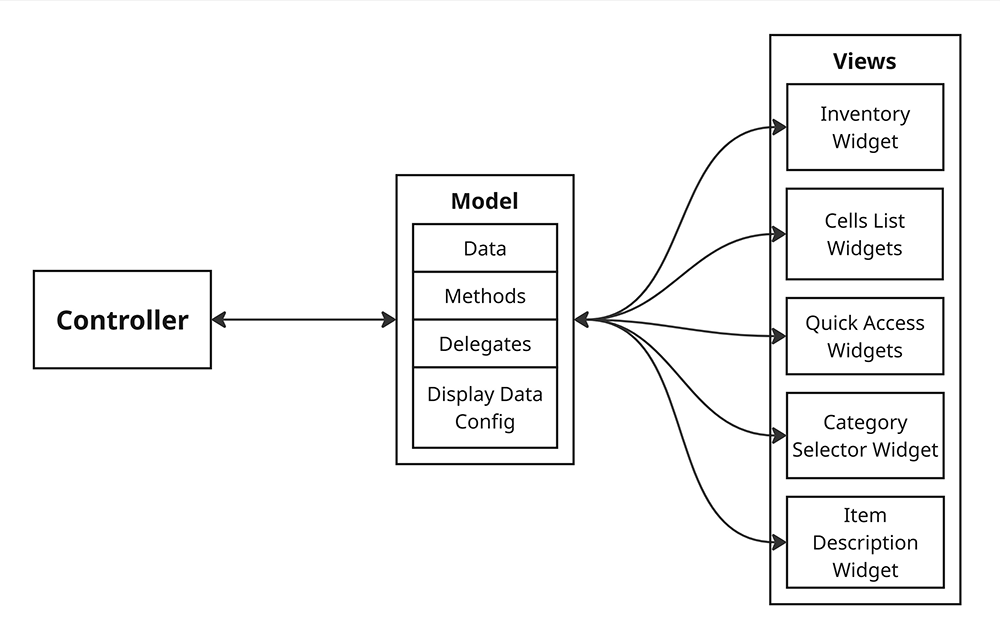
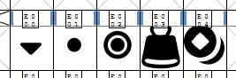
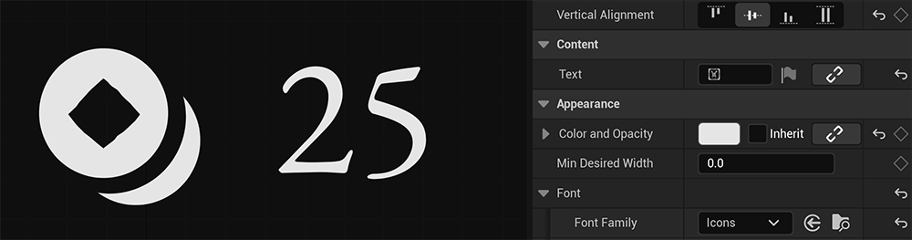

I went through the entire process from designing the game UI to writing its logic and optimizing it, to get a deeper understanding of the full interface development cycle.

### Getting Started

My initial paper sketches gradually took shape and developed their style in Adobe Illustrator. After several lengthy iterations and a final polish in Figma, I arrived at the version you see below.

{: width="1920" height="1080" }
_The inventory design was created entirely by me in **Adobe Illustrator**, except for the background image_

I exported each element separately and started putting the screen together in Unreal Engine. I wanted to figure out which elements would benefit from being combined into texture atlases and compare the number of draw calls before and after optimization. I'll go into more detail about that later, but first, let's take a look at the inventory's features and logic.

### Features
- A category system with two item lists. Each main category tab has two subcategories.
- Custom smooth scrolling that controls both item lists simultaneously.
- Universal inventory navigation with support for mouse, keyboard, and gamepad.
- Two quick-access bars where items from the inventory can be assigned.
- Flexible Drag & Drop logic, allowing items to be moved and swapped between slots.
- A detailed description panel for the selected item.
- Full support for Unreal Engine's built-in localization system.



### Architecture and Logic

I designed the architecture around the `Model-View-Controller` pattern. The `Model` holds the data and acts as a bridge between the inventory logic `(Controller)` and its visual representation `(View)`. The entire system is **Event-driven**, with communication handled through delegates. This eliminates the need for `Tick` and helps prevent tangled dependencies.

> The entire project is built around a component-based approach. This system allows me to register only the components needed for a particular level. If the inventory component isn't registered on the current level, its corresponding tab won't be created in the _Player Menu_ (a unified panel with tabs for Map, Quests, Inventory, Journal, and Skills).
{: .prompt-info }

{: width="600" height="382" .w-50 .right}
This gives me separate `Controller`, `Model` and `View` components for the inventory. Each slot also has its own data model. A slot can either be empty or contain item data. This approach makes it easy to move items between slots and update individual slot widgets without having to refresh the entire list.

The item list itself is a `TileView`, which can handle a large number of elements because slot widgets are reused as you scroll. This reduces memory usage and the workload of the Garbage Collector.

### Optimization

Item icon references in the `Data Table` are implemented using soft object pointers `(TSoftObjectPtr)`. This means that initializing the item table doesn't load all textures into memory at once. Instead, the required assets are loaded asynchronously when the inventory is opened.

To minimize the number of _draw calls_ and _render state changes_, nd to avoid loading each image separately, I created several texture atlases. Using these atlases cut the number of draw calls in half.

{: width="267" height="88" .w-50 .right}
{: width="600" height="158" .w-50 .right}
For some icons, I created a custom font instead of using raster images. Unlike regular textures, which store color values for each texel, `SDF (Signed Distance Field)` stores the distance to the shape's outline. This allows the GPU to interpolate distance values during rendering, keeping the image sharp at any screen scale while reducing video memory usage.

### Roadmap
- Visual feedback for slots during Drag & Drop
- Additional buttons for item actions, along with an on-screen hints panel showing key bindings at the bottom of the screen
- Full gamepad support
- New UI animations
- Particle effects integration
- State logic to intelligently return to previously visited game screens (Common UI)

