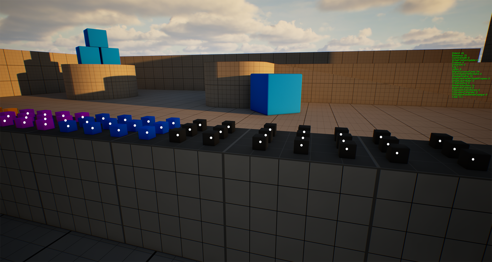
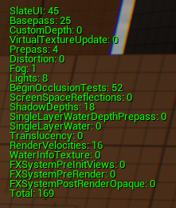
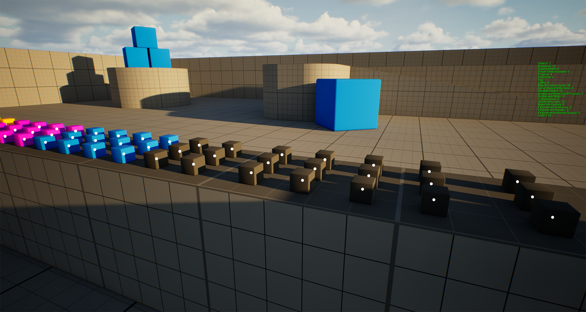
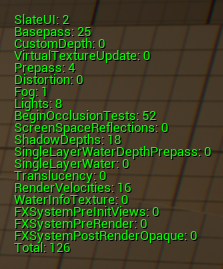

A custom tracking system for UI markers attached to 3D objects.

### The Goal

The goal was to implement UI markers for interactive objects in 3D space. The markers always face the camera and scale proportionally based on their distance from it. This ensures they always appear flat on the screen and maintain a consistent visual size.

### The Problem

Using `Widget Component` creates a separate isolated container for each marker. As a result, the widgets cannot be batched, and each new marker adds at least **+1 draw call**. On top of that, each marker performs its own 3D-to-2D coordinate transformation.

{: width="1920" height="1025" }
{: width="221" height="260" }

### The Solution

I developed a custom tracker for these widgets. It centrally handles all visible markers, converting their positions from `world space` to `screen space` and storing them inside a shared UI container. This allows the widgets to be batched together. To avoid constantly creating and destroying UI elements, I also implemented a `widget pool` that reuses previously created widgets.

### The Result

Regardless of how many active markers are on screen, they are all rendered in just **1 draw call**. I also gained full control over coordinate transformations, widget creation, and marker visibility.

{: width="1920" height="1025" }
{: width="223" height="269" }
